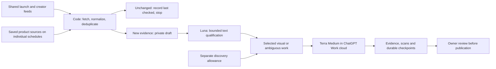

# Collection at 10,000 products

Status: backend queue safeguards implemented; recurring collection remains paused. This is not a claim of live 10,000-product coverage.

## Work allocation

A product is an identity, not one daily browser task. Its landing page, pricing, advertiser, creator mentions and authenticated funnel have different sources and freshness. Shared feeds have unique source URLs, so the same feed is not registered per product. Shared channel ingestion and matching many product domains is the next provider optimization; the current YouTube adapter still performs bounded per-product searches. No broad cross-product fan-out is being claimed as implemented.

Work uses the database rather than chat memory. `research_context` returns the versioned playbook, current allowances, checkpoints and a paginated directory. `afterProductId` follows `nextProductCursor`. Directory order does not assign work. Before browser research, Work must `claim_capture_job`, read the returned source/product history, then complete/fail and checkpoint. Existing native prompts fetch this updated playbook at run start.

## Implemented limits

| Lane | Default attempts per UTC day | Concurrent leases | Maximum queued/running jobs |
| --- | ---: | ---: | ---: |
| Code HTTP/RSS | 1,000 | 4 | 900 |
| Terra browser monitoring | 12 | 1 | 80 |
| Discovery / upfront qualification | 3 | 1 | 20 |

These are conservative ceilings, not throughput promises. Claims and debits commit in one D1 transaction. Retries and reclaimed expired leases spend another attempt; completed work does not refund usage. Allowances reset at 00:00 UTC. Queues are selected oldest-due first, with at most 200 HTTP, 12 browser and 3 discovery additions per enqueue call. Unselected sources keep their overdue position. One source cannot accumulate multiple unfinished jobs. Separate queue space and allowances protect discovery from maintenance.

An admin can change the ceilings through `PATCH /api/v1/admin/collection/policy/{lane}` with `dailyLimit` and `concurrencyLimit`; zero pauses a lane. `GET /api/v1/admin/collection/status` reports usage, backlog and source check coverage. Claims recheck eligibility: archived products and unaccepted research cannot enter routine monitoring. An explicitly admin-prepared discovery source can investigate a pending product. Collectors cannot approve products or raise limits.

The HTTP runner (`pnpm collect <1-100>`) sends stored ETag/Last-Modified validators. A 304 or identical normalized evidence fingerprint updates source freshness without duplicating evidence or involving a model. Last checked and last changed are separate. Metadata hashes ignore changing server headers. After each three unchanged public-page checks, the interval doubles, up to eight times its configured base and at most 720 hours; a detected change restores the base. This checks HTML metadata, not all page content or an authenticated paywall. RSS retains its base cadence and reads at most 20 entries per response.

Blocked sources can be disabled for review through `fail_capture_job(blocked=true)`; 401/403 HTTP responses do this automatically. Other errors have bounded retries and source cooldowns. Terminal job history older than 30 days is pruned in bounded batches; source freshness and evidence remain. Daily usage is retained for 35 days. Raw screenshots are not silently deleted.

These application limits do not meter ChatGPT tokens or stop an agent from navigating outside its instructions. The saved playbook bounds each claimed investigation to five navigations/eight minutes. Account-level credits/overage settings must separately remain disabled for a strict spending boundary. There is no paid model/API fallback in this change.

## A realistic 10,000-product schedule

Illustrative capacity planning, not a cohort assignment or freshness guarantee:

| Cohort | Products | Public sources per product | Cadence | Average checks/day |
| --- | ---: | ---: | --- | ---: |
| Hot | 100 | 2 | Daily | 200 |
| Warm | 900 | 2 | Weekly | 257 |
| Long tail | 9,000 | 1 | Every 30 days | 300 |
| Total | 10,000 | | | About 757 |

Stagger due dates when importing a cohort. That leaves roughly 243 of the default 1,000 HTTP attempts for retries and shared feeds, before other provider/runtime constraints. The configured cron currently enqueues only once per day, and the Node HTTP runner has not been installed as an unattended cloud runner. Achieving this throughput therefore still needs a bounded runner/drain cadence, measured against actual service allowances. Neither recurring research nor this extra runner is enabled by this change.

Twelve browser source visits per day cannot refresh all ads, creator mentions and authenticated funnels across 10,000 products daily. Terra needs selection: important changes, priority products, rotating samples and deliberately selected deep teardowns. Each source retains its actual check time; missing coverage stays unknown/stale. No blanket daily-fresh claim.

## Model choice and costs

Official documentation checked November 4, 2026 lists GPT-6 Luna (not an established GPT-6.1 Luna here). Standard Work credit rates per million tokens are Luna 2.5 input / 12.5 output, versus GPT-6.1 Terra 25 / 125. The nominal input/output ratio is ten to one; retries, reasoning and task length change actual cost per useful result. Included subscription allowances are not determined by these rates alone. Work and Codex share usage.

Implemented workflow: code first; actual Luna Medium Work tasks classify supplied primary text; Terra Medium handles visual/browser work and uncertain cases. The18-record pilot found real naming/source ambiguities and preserved unknown company size. Follow-up batches are25 records, with self-contained instructions/source context and persisted JSON outputs. The existing Work chat keeps its selected model; the operator can submit/read through the desktop connector without browser setup for every batch. These are supervised initial qualification runs, not a paid API model router. No observed per-task cost ratio is claimed, and the saved recurring browser task remains Terra and paused.

- [OpenAI model roles](https://learn.chatgpt.com/docs/models)
- [OpenAI Work pricing and shared usage](https://learn.chatgpt.com/docs/pricing)
- [D1 pricing](https://developers.cloudflare.com/d1/platform/pricing/): Free includes 5 million rows read and 100,000 written per day. Indexed writes count too; ceilings are account-wide, not a private allowance for Arcex.
- [D1 limits](https://developers.cloudflare.com/d1/platform/limits/): Free database maximum 500 MB, and 50 queries per Worker invocation. Queue completion is bounded to 20 evidence items to leave room for access checks and state updates.
- [YouTube quota](https://developers.google.com/youtube/data/getting-started#quota-usage): default 100 search calls/day and 10,000 other units/day. The current adapter uses lower application limits and caching; it cannot search 10,000 products daily.

The existing private evidence budget is 50 MB. Even one 200 KB capture for each of 10,000 products would need about 2 GB. A complete visual archive at that scale does not fit today's storage budget. Keep a selected Vault cohort and stop uploads at the cap; expansion needs an explicit later storage/budget decision. R2 remains disabled.

## Verification

A Miniflare test with 10,000 HTTP sources plus 32 browser/discovery sources verifies bounded enqueueing, distinct source jobs, preserved overdue work, concurrent claim budget enforcement, independent discovery allowance, blocked-source disable, and unchanged completion without new evidence. This exercises SQLite/runtime behavior, not live browser reliability or production throughput. All 27 tests pass, including existing access, publication, billing and collector coverage. An isolated local Worker smoke check passed; a real example.com fetch produced a draft, and its second conditional request returned 304 without another evidence record. No expensive browser run is needed to test these database invariants.
